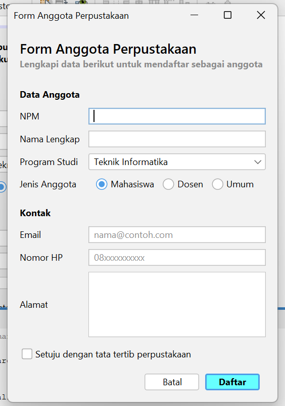
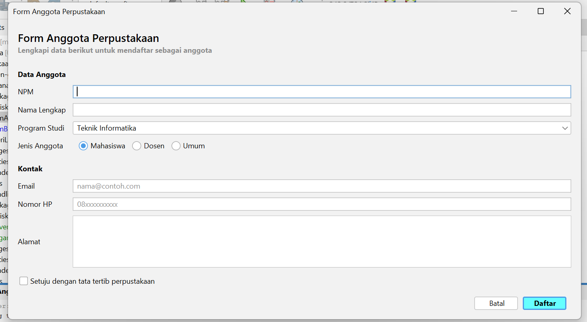
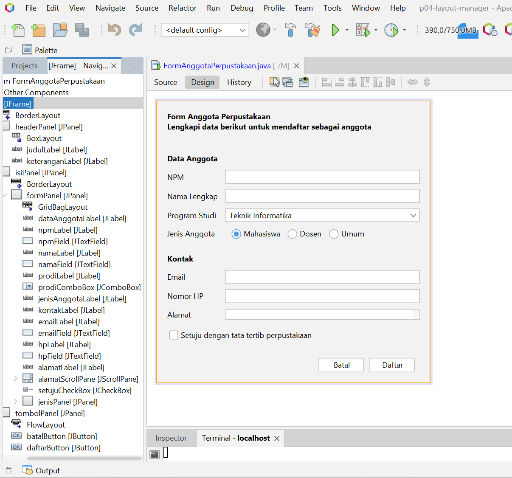

# P04 - Layout Manager dan Desain Form

Nama         : Nadiya Ramadani
NPM          : 2410010237
Kelas        : 5C Reguler Pagi Banjarmasin
Mata Kuliah  : PBO 2

## 1. Jawaban Pertanyaan Refleksi

1. karena posisi dan ukuran komponennya dipatok pakai angka tetap. Jadi kalau jendela diperbesar atau dikecilkan, komponennya tidak ikut menyesuaikan. Kalau dibuka di komputer lain yang fontnya atau resolusinya beda, tampilannya juga bisa berantakan.

2. Di FlowLayout, ukuran komponen tetap sama. Yang berubah hanya susunannya, misalnya ruang kosong bertambah atau komponen pindah baris. Di GridLayout, susunan barisnya tetap, tapi semua komponen ikut membesar dengan ukuran yang sama rata.

3.  Weight X dipakai untuk mengatur pembagian sisa ruang secara horizontal. Kalau nilainya 0, kolom tidak ikut melebar, dan kalau 1.0, kolom ikut melebar. Fill dipakai untuk menentukan apakah komponen mengisi penuh selnya, misalnya HORIZONTAL supaya text field memenuhi lebar kolom. Keduanya saya pakai bersamaan supaya text field benar-benar ikut melebar saat jendela diperbesar.

5. Kalau formPanel langsung ditaruh di Center, form akan ditarik memenuhi seluruh area sehingga jarak antar field jadi renggang dan tidak rapi. Dengan ditaruh di North, form hanya setinggi ukuran aslinya dan menempel di bagian atas. Pembungkus isiPanel juga berguna untuk memberi jarak (margin) di sekeliling form.
   
6. Konsistensi: Semua label saya buat rata kiri, jarak antar komponen memakai Insets yang sama, dan semua text field memakai fill yang sama. Buktinya bisa dilihat pada kode constraint dan screenshot form.
- Fleksibilitas (responsif): Saya memakai GridBagLayout dengan weightx 1.0 pada kolom input, sehingga saat jendela dilebarkan text field ikut melebar. Buktinya adalah screenshot form sebelum dan sesudah di-resize, serta tidak adanya null layout di kode

## 2. Sketsa dan Tabel Rancangan

| Bagian | Panel | Layout |
|---|---|---|
| Jendela | JFrame | Border Layout |
| Header | headerPanel (North) | Box Layout, Y Axis |
| Isi form | isiPanel (Center) berisi formPanel (North) | isiPanel: Border Layout, formPanel: Grid Bag Layout |
| Tombol | tombolPanel (South) | Flow Layout, Alignment Right |

## 3. Screenshot FormAnggotaPerpustakaan

Ukuran awal:

Saat dilebarkan:

## 4. Screenshot Tab Design (Navigator)

## 5. Jawaban Eksperimen dan Saran Teman

### Praktikum 2
1. flowPanel Alignment Center, jendela dikecilkan: ...
2. gridPanel Rows 0 dan Columns 2: ...
3. boxPanel maximumSize 32767 dan Vertical Strut: ...

### Praktikum 4
1. Weight X namaField 0.0, jendela dilebarkan: ...
2. formPanel Direction Center, jendela ditinggikan: ...
3. Tanpa setMinimumSize, jendela dikecilkan: ...

### Saran dari teman (Tahap 4)
- ...

## 6. Deklarasi Penggunaan AI

Saya menggunakan Claude untuk membantu memahami GridBagLayout dan
memperbaiki error pada form. Seluruh kode saya periksa dan jalankan sendiri.
