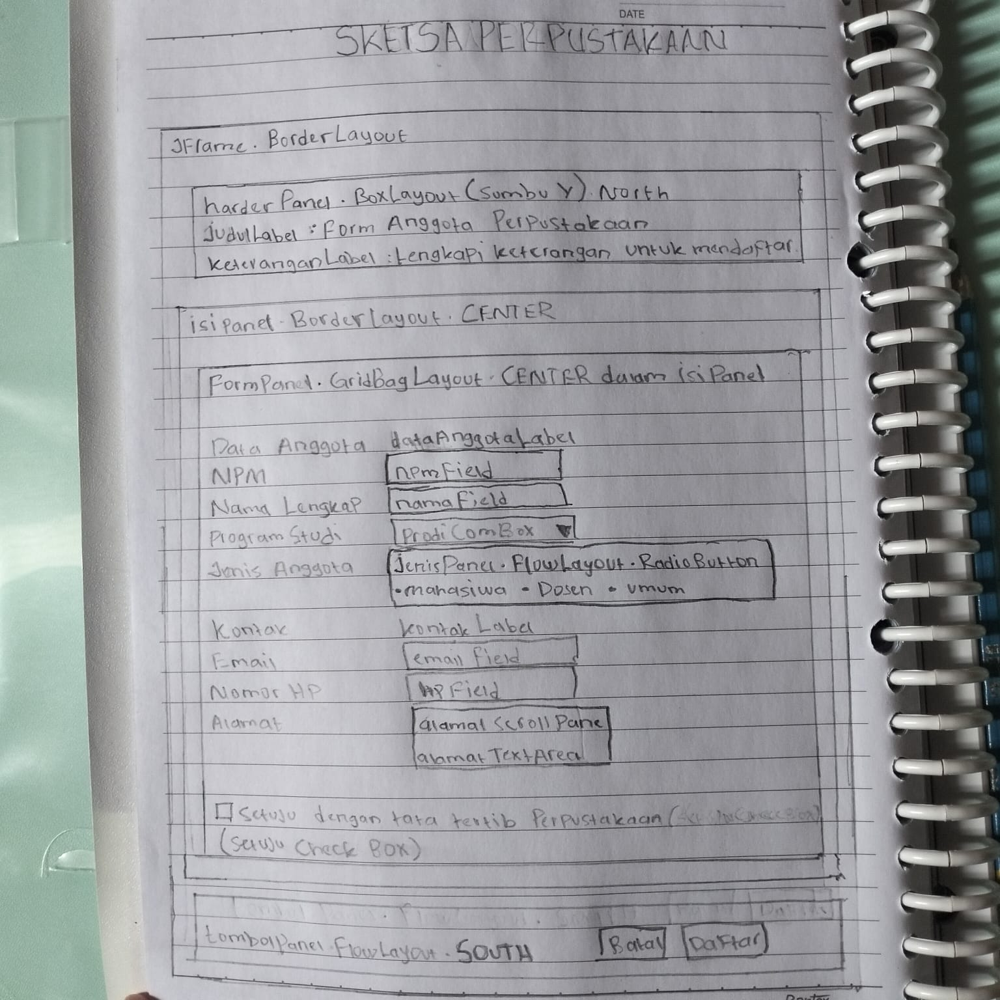

# P04 - Layout Manager dan Desain Form

Nama         : Nadiya Ramadani
NPM          : 2410010237
Kelas        : 5C Reguler Pagi Banjarmasin
Mata Kuliah  : PBO 2

## 1. Jawaban Pertanyaan Refleksi

1. karena posisi dan ukuran komponennya dipatok pakai angka tetap. Jadi kalau jendela diperbesar atau dikecilkan, komponennya tidak ikut menyesuaikan. Kalau dibuka di komputer lain yang fontnya atau resolusinya beda, tampilannya juga bisa berantakan.

2. Di FlowLayout, ukuran komponen tetap sama. Yang berubah hanya susunannya, misalnya ruang kosong bertambah atau komponen pindah baris. Di GridLayout, susunan barisnya tetap, tapi semua komponen ikut membesar dengan ukuran yang sama rata.

3.  Weight X dipakai untuk mengatur pembagian sisa ruang secara horizontal. Kalau nilainya 0, kolom tidak ikut melebar, dan kalau 1.0, kolom ikut melebar. Fill dipakai untuk menentukan apakah komponen mengisi penuh selnya, misalnya HORIZONTAL supaya text field memenuhi lebar kolom. Keduanya saya pakai bersamaan supaya text field benar-benar ikut melebar saat jendela diperbesar.

5. Kalau formPanel langsung ditaruh di Center, form akan ditarik memenuhi seluruh area sehingga jarak antar field jadi renggang dan tidak rapi. Dengan ditaruh di North, form hanya setinggi ukuran aslinya dan menempel di bagian atas. Pembungkus isiPanel juga berguna untuk memberi jarak (margin) di sekeliling form.
   
6. Konsistensi: Semua label saya buat rata kiri, jarak antar komponen memakai Insets yang sama, dan semua text field memakai fill yang sama. Buktinya bisa dilihat pada kode constraint dan screenshot form.
- Fleksibilitas (responsif): Saya memakai GridBagLayout dengan weightx 1.0 pada kolom input, sehingga saat jendela dilebarkan text field ikut melebar. Buktinya adalah screenshot form sebelum dan sesudah di-resize, serta tidak adanya null layout di kode

## 2. Sketsa dan Tabel Rancangan

| Bagian | Panel | Layout |
|---|---|---|
| Jendela | JFrame | Border Layout |
| Header | headerPanel (North) | Box Layout, Y Axis |
| Isi form | isiPanel (Center) berisi formPanel (North) | isiPanel: Border Layout, formPanel: Grid Bag Layout |
| Tombol | tombolPanel (South) | Flow Layout, Alignment Right |

## 3. Screenshot FormAnggotaPerpustakaan

Ukuran awal:

Saat dilebarkan:

## 4. Screenshot Tab Design (Navigator)

## 5. Jawaban Eksperimen dan Saran Teman

### Praktikum 2
1. Tombol berpindah dari rata kiri ke tengah panel. Saat jendela dikecilkan,        tombol yang tidak muat turun ke baris berikutnya dan tiap baris tetap terpusat
2. Terbentuk 5 baris. Ada 9 tombol, dan saat Rows = 0 jumlah baris dihitung         otomatis dari Columns: ⌈9 ÷ 2⌉ = 5. Baris terakhir hanya berisi tombol “9”,      sehingga satu sel di kanan bawah kosong.
3. Lebar keempat tombol (Dashboard, Data Mahasiswa, Data Mata Kuliah, Laporan)      berubah dari sebesar teksnya masing-masing menjadi sama lebar dan memenuhi       seluruh lebar panel, serta ikut melebar saat jendela dilebarkan. Tingginya       tetap.Penyebabnya, BoxLayout hanya melebarkan komponen sampai batas              maximumSize. Dengan lebar 32767, batasnya hampir tak terbatas, sehingga          tombol mengisi lebar panel.Vertical Strut menambahkan celah vertikal tetap di    antara tombol, sehingga tombol tidak lagi saling menempel.

### Praktikum 4
1. Weight X namaField = 0.0, lalu jendela dilebarkan
   Kemungkinan besar namaField tetap ikut melebar, tidak ada perubahan.
2. North: form menempel di atas dan hanya setinggi ukuran aslinya. Tinggi           tambahan menjadi ruang kosong di antara form dan tombol Batal/Simpan.
   Center: form mengisi seluruh sisa tinggi, sehingga isinya ikut meregang          (terutama kotak Alamat jika weighty-nya > 0).
3. Tombol Batal/Simpan di pojok kanan bawah terpotong lebih dulu, disusul isian     yang menyempit dan judul yang terpotong di kanan. Baris itu berfungsi            mengunci ukuran jendela agar tidak lebih kecil dari ukuran awalnya.

### Saran dari teman (Tahap 4)
## Tahap 4: Saling Menilai

| No | Pemeriksaan | Ya atau Belum | Catatan |
|----|-------------|---------------|---------|
| 1 | Label singkat, jelas, dan sejajar | Ya | Label rata kiri dan singkat |
| 2 | Isian dikelompokkan dengan judul bagian | Ya | Ada judul "Data Anggota" dan "Kontak" |
| 3 | Placeholder dipakai untuk isian yang punya format | Ya | Email, dan Nomor HP sudah memakai placeholder |
| 4 | Komponen sesuai jenis data | Ya | ComboBox untuk prodi, radio button untuk jenis anggota, checkbox untuk persetujuan, text area untuk alamat |
| 5 | Tombol utama menonjol dan berada di kanan bawah | Belum | Posisi sudah di kanan bawah, tetapi tombol Daftar belum dibedakan dari Batal |
| 6 | Jarak antar komponen konsisten | Ya | Jarak antar baris seragam |
| 7 | Form tetap rapi saat jendela dilebarkan dan ditinggikan | Ya | Isian ikut melebar dan tata letak tetap rapi |
| 8 | Tampilan dibuat dengan JFrame Form dan layout manager, bukan Null Layout atau Absolute Layout | Ya | Memakai BorderLayout, BoxLayout, GridBagLayout, dan FlowLayout |

### Saran perbaikan
1. Buat tombol Daftar lebih menonjol (warna latar berbeda dan huruf tebal) dibanding tombol Batal.

## 6. Deklarasi Penggunaan AI

Saya menggunakan Claude untuk membantu memahami GridBagLayout dan
memperbaiki error pada form. Seluruh kode saya periksa dan jalankan sendiri.
